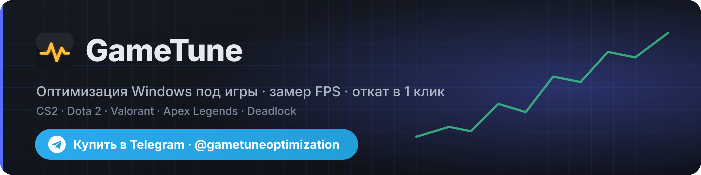

  

  
  

GameTune
Утилита для Windows 10/11, которая настраивает ПК под игры и показывает результат в цифрах. Каждое изменение можно откатить одной кнопкой.
Купить
Ключ активации продаётся в Telegram-канале @gametuneoptimization. Там же новости, обновления и поддержка.
Что умеет
Настройка Windows. Три режима: «Стандарт», «Глубокий» и «Максимум». Программа сама подбирает параметры под ваш процессор и видеокарту: план питания, HAGS, игровой режим, энергосбережение USB, PCIe и сетевой карты.
Облегчить Windows. Отключает телеметрию, рекламу и рекомендации в меню «Пуск», виджеты, Copilot и Recall, а также лишние службы и задачи.
NVIDIA. Безопасный игровой профиль драйвера через NVIDIA Profile Inspector.
Конфиги игр. Готовые пресеты для CS2, Dota 2, Valorant, Apex Legends и Deadlock: «Баланс» и «Максимум FPS». Античиты (VAC, Vanguard, EAC) не трогаются.
Замер FPS. Средний FPS, 1% и 0,1% low, фризы, упор в процессор или видеокарту. Можно сравнить результат до и после настройки.
Диагностика. Ищет частые причины лагов: монитор работает не на своей частоте, выключен XMP/EXPO, мешают оверлеи, драйвер не подходит к вашей версии Windows, и другие.
Перед игрой. Закрывает лишние программы, а Discord, Telegram и Spotify оставляет открытыми с пониженным приоритетом.
Безопасность
Перед настройкой создаётся точка восстановления Windows.
Программа запоминает исходные значения и возвращает их по кнопке «Откатить».
Античиты, драйверы и файлы игр не изменяются.
Обновления подписаны продавцом. Программа ставит только проверенные версии.
Требования
Windows 10 или 11, 64-бит.
Права администратора: Windows один раз спросит разрешение.
Microsoft Edge или Google Chrome для окна программы (Edge есть в Windows по умолчанию).
Установка
Купите ключ в @gametuneoptimization.
Скачайте `GameTune.exe` из раздела Releases.
Запустите его и введите ключ активации.
Ключ привязан к одному компьютеру.
> Скачанный exe не подписан сертификатом, поэтому Windows SmartScreen может показать предупреждение. Нажмите «Подробнее», затем «Выполнить в любом случае».
Обновления
GameTune сам проверяет новые версии при запуске. Когда выйдет обновление, в шапке программы появится кнопка «Обновление». Нажмите её, затем «Обновить». Лицензия и настройки сохранятся.
Поддержка
Если после настройки FPS стал ниже: «Диагностика» → «Сохранить отчёт». Файл появится на рабочем столе. Отправьте его в @gametuneoptimization, и по нему будет видно, что не подошло вашему ПК.
